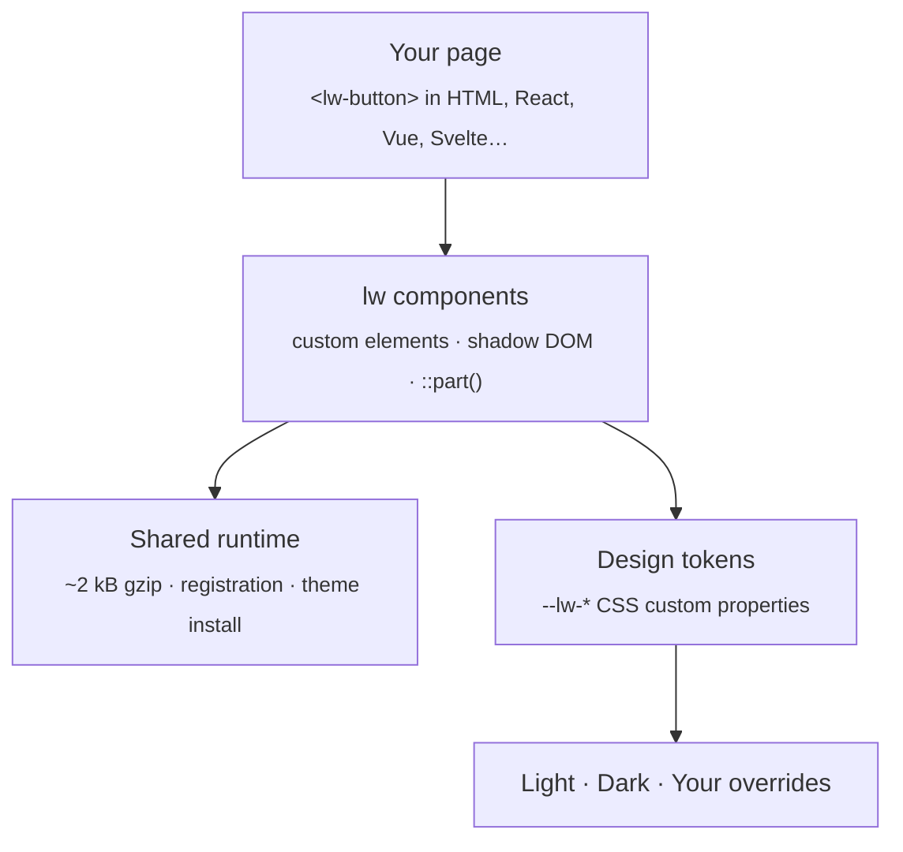

<div align="center">
  
</div>
</br>
<div align="center">

  
  
  
  

</div>

lw is a set of *animated UI components* built with **SCSS** and **vanilla JavaScript Web Components**. Rather than shipping a framework, it gives you standard custom elements that work everywhere, with *zero runtime dependencies* and nothing to configure.<br>
<sub>It serves as the common UI layer for LowerSoft's web products and is under active development.</sub>

<hr>
<div align="center">
  <a href="#usage">Usage</a> · 
  <a href="#how-it-works-explained-for-just-project-infrastructure">How it Works</a> · 
  <a href="#contact">Contact</a> ·
  <a href="#credits">Credits</a> ·
  <a href="#contribute">Contribute</a> ·
  <a href="#license">License</a>
</div>
<hr>

### Usage
Everything below works the same in plain HTML, React, Vue, Svelte or anything else. No framework needed(btw).
#### 1.1 Get the package
```bash
npm install @lowersoft/lw
```
That is the only install step. There are no peer dependencies and no build plugins to configure.

#### 1.2 Import and render
Import only what you need, every component is a separate entry point:
```js
import '@lowersoft/lw/components/button';
```
Or register everything at once:
```js
import '@lowersoft/lw';
```
Then use it like any other HTML element:
```html
<lw-button variant="outline" size="lg">Get started</lw-button>
```
> Components render with the default theme right after the import. There is nothing to wrap, provide or initialize.

#### 1.3 Theming
The default theme is installed automatically on first use. It follows `prefers-color-scheme`; force a scheme with `data-theme` on `<html>`:
```html
<html data-theme="dark">
```
Every design token is a `--lw-*` CSS custom property. Override any of them, default values have zero specificity, so plain declarations win:
```css
:root {
  --lw-color-primary: #6d28d9;
  --lw-radius-md: 9999px;
}
```
Style component internals with `::part()`:
```css
lw-button::part(button) {
  letter-spacing: 0.02em;
}
```
Need the tokens in your own CSS before JavaScript loads? Link the static theme:
```js
import '@lowersoft/lw/themes.css';
```

#### 1.4 SCSS
SCSS users can reuse the token functions and mixins:
```scss
@use '@lowersoft/lw/scss' as lw;

.card {
  border-radius: lw.v(radius-lg);
}
```

#### 1.5 Handy commands
| Command | What it does |
|---|---|
| `npm install` | Install the development dependencies |
| `npm run storybook` | Component docs and playground |
| `npm run build` | Library build into `dist/` |
| `npm run new <name> [Category]` | Scaffold a new component |

Something broke? Delete `node_modules/` and `dist/`, run `npm install` again and retry. Still stuck? [Open an issue](https://github.com/lowersoft/web/issues).

### How it Works (explained for just project infrastructure)
The idea is simple: **use the platform and put a thin, boring layer on top of it.** Components are plain custom elements, styling is plain CSS custom properties, and the small shared runtime only handles what you would otherwise repeat in every component (theme installation, registration, animation helpers).

#### 2.1 The big picture

Your code only ever talks to the HTML element and its attributes. Nothing else leaks upward.

#### 2.2 Repo layout
```
web/
├── src/
│   ├── components/   One folder per component, each its own entry point
│   ├── runtime/      The shared runtime
│   ├── scss/         Token functions and mixins
│   └── themes/       Default theme and static themes.css
├── scripts/          Component scaffolding (npm run new)
├── .storybook/       Component docs and playground
├── dist/             Library build output
├── CONTRIBUTING.md
└── ROADMAP.md
```
> The tree above is a simplified overview, folder names may differ slightly in the repo.

#### 2.3 Dependencies: none
lw has **zero runtime dependencies**. Nothing is bundled from third parties, nothing is patched, and every component is a separate entry point, so you only pay for what you import. The shared runtime is about 2 kB (gzip).

#### 2.4 Component lifecycle
Importing a component registers its custom element. From there the browser owns the lifecycle:
```
import '@lowersoft/lw/components/button'
 ├─ shared runtime loads (once, shared by every component)
 ├─ default theme is installed on first use
 ├─ customElements.define('lw-button', …)
 └─ every <lw-button> on the page
     ├─ connectedCallback   ← render + attach animations
     ├─ attributeChangedCallback (variant, size, …)
     └─ disconnectedCallback ← cleanup
```
Because they are standard custom elements, they work in any framework that can render HTML.

#### 2.5 Theming
Design tokens are installed as CSS custom properties, and components read them at render time:
```
default theme ──install──▶ :root { --lw-* } ──read──▶ components
      ▲                          ▲
      │                          └── your overrides win (default values have zero specificity)
      └── prefers-color-scheme / data-theme picks light or dark
```
- Defaults are declared with zero specificity, so any plain declaration in your CSS overrides them.
- `data-theme` on `<html>` forces a scheme, otherwise `prefers-color-scheme` decides.
- Component internals are exposed through `::part()`, so you can restyle them without touching the source.
- `themes.css` is the same set of tokens as a static file, for use before JavaScript loads.

#### 2.6 Build system
| Piece | What it does |
|---|---|
| **SCSS** | Source of all component styles and the exported token functions and mixins. |
| **`npm run build`** | Builds the library into `dist/`, one entry point per component plus the full bundle. |
| **Storybook** | Component docs and playground, started with `npm run storybook`. |
| **`npm run new`** | Scaffolds a component (and its story) so every component starts with the same structure. |

#### 2.7 Extending it
Want a new component? Run `npm run new <name> [Category]`, fill in the generated files and it becomes its own entry point, the same way every existing component is done: no extra libraries, one import from your app. See [CONTRIBUTING.md](CONTRIBUTING.md) and [ROADMAP.md](ROADMAP.md).

### Contact
Not sure where to start? Pick the row that matches your situation, so your message reaches the right people on the first try.
| I want to... | Reach us via |
|----|--|
| Ask about **licensing or copyright** | [info@lowersoft.com](mailto:info@lowersoft.com) |
| Follow up on a **repo issue** that hasn't had a reply | [support@lowersoft.com](mailto:support@lowersoft.com) |
| Report a problem with the **UI of a LowerSoft product** I own | Open a ticket on [lowersoft.com](https://lowersoft.com) |
| Learn what lw brings to our **products** | Live chat on [lowersoft.com](https://lowersoft.com), no sign-in needed |

#### A few details
- **Licensing & copyright** (`info@`): using lw in your own project, redistribution, attribution or anything legal-sounding. If in doubt, ask before you ship.
- **Unanswered issues** (`support@`): please open a [GitHub issue](https://github.com/lowersoft/web/issues) first. It keeps the answer public and useful for everyone. If it has been quiet for a while, send us a short mail with the issue link and we'll pick it up.
- **Product tickets**: if a LowerSoft product you bought has a UI problem (layout, theme, crashes in the interface), a ticket is the fastest route because it is tied to your account and product version. Include a screenshot and your browser.
- **Live chat**: it connects you straight to our customer relations team, no account required.

> **Heads up:** this is a component library repo, not a product helpdesk. Product questions go to a ticket, library bugs go to GitHub issues. Everything else is welcome in the table above.

### Credits
Built and maintained by LowerSoft. Every part of this project is shaped by our own time and effort, and we're not planning to slow down. 💙

#### Contributors

Everyone who has helped along the way shows up here automatically:

<a href="https://github.com/lowersoft/web/graphs/contributors">
  
</a>

Want to see your face here? Head over to [Contribute](#contribute).

### Contribute
Our goal is to make building animated, accessible web UI easier, tidier and more reliable for everyone. Any contribution that moves the project in that direction is welcome, from a one-character typo fix to a new component. Pull requests and forks are always appreciated.

| I want to... | Do this |
|---|---|
| Report a bug | Open an [issue](https://github.com/lowersoft/web/issues) with the steps to reproduce, the expected result and the actual result |
| Suggest an idea | Open an [issue](https://github.com/lowersoft/web/issues); rough ideas are fine |
| Fix or add something | Fork the repo and send a pull request |
| Improve the documentation | Send a pull request; wording, missing steps and typos are all welcome |
| Test on my browser | Run Storybook and report the result, especially on less common browsers |

#### Sending a pull request
1. **Fork** the repository and create a branch from `main` (for example `fix/button-focus` or `feat/tooltip`).
2. **Build** it with `npm run build` and make sure it compiles without warnings.
3. **Test** it by opening the component in Storybook (`npm run storybook`).
4. **Open the pull request** and describe what changed and why. Screenshots or recordings help for UI and animation changes.

For larger changes, please open an issue first so we can agree on the direction before you invest the time.

#### Guidelines
- Vanilla JavaScript and SCSS, no runtime dependencies.
- Code, comments and documentation are written in English.
- Every design token is a `--lw-*` CSS custom property, and defaults keep zero specificity.
- Components expose their internals through `::part()`.
- Commit messages start with a short summary line, followed by a brief explanation when the reasoning is not obvious.

Questions about contributing? See [Contact](#contact) and [CONTRIBUTING.md](CONTRIBUTING.md).

### License
lw is released under the **[MIT License](LICENSE)**. You are free to use, copy, modify, merge, publish, distribute, sublicense and sell copies of the software, including in commercial projects, as long as the copyright notice and the license text are included in all copies or substantial portions of it.

The software is provided "as is", without warranty of any kind.

#### Third-party software
lw has no runtime dependencies, so nothing from third parties is shipped in your bundle.

Questions about licensing or copyright? See [Contact](#contact).

<div align="center">
  Best regards, <b>LowerSoft Team</b>. <br>
</div>
